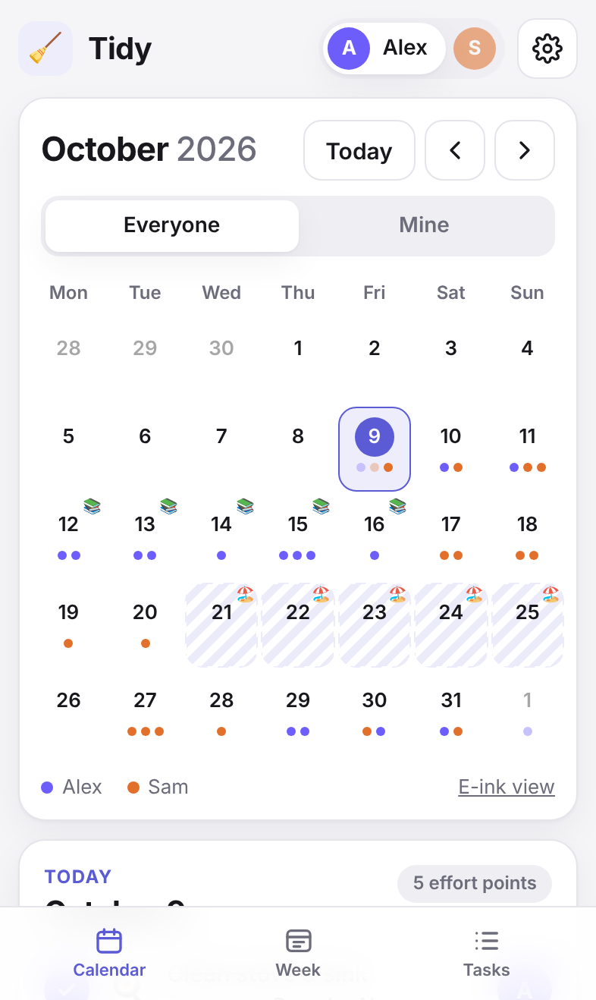
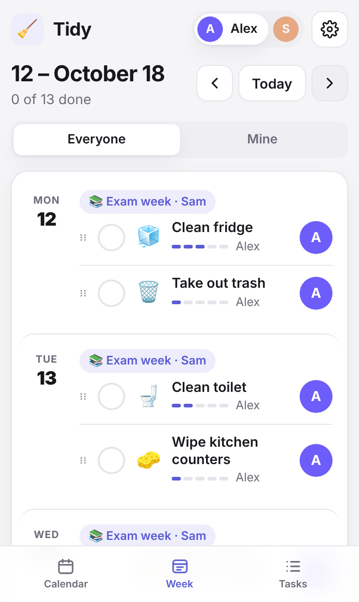
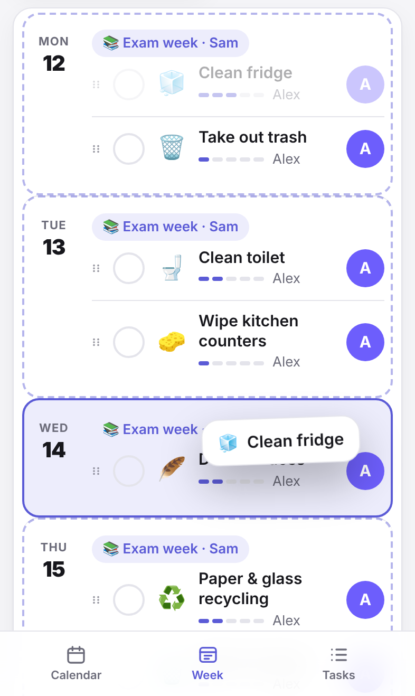
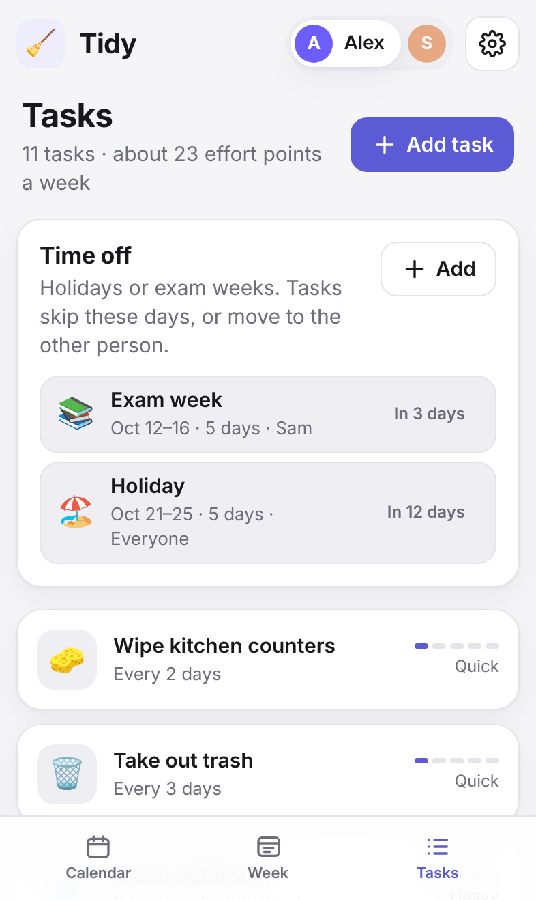
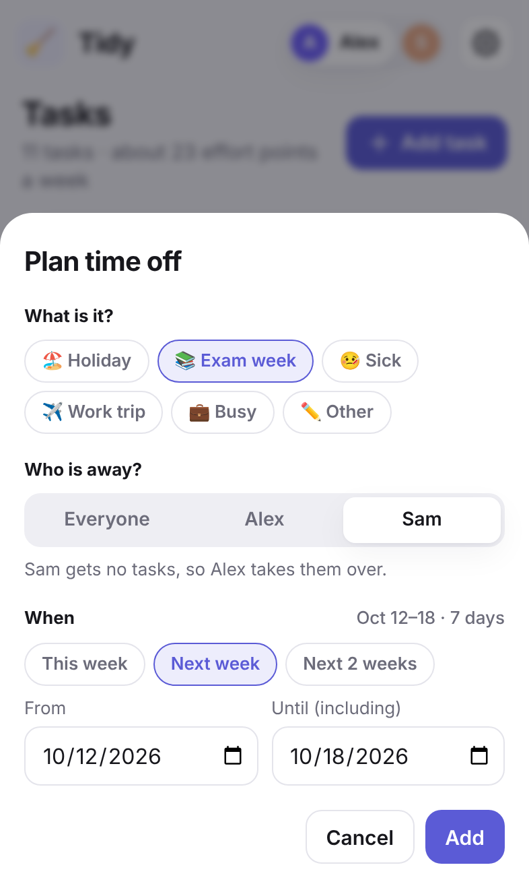
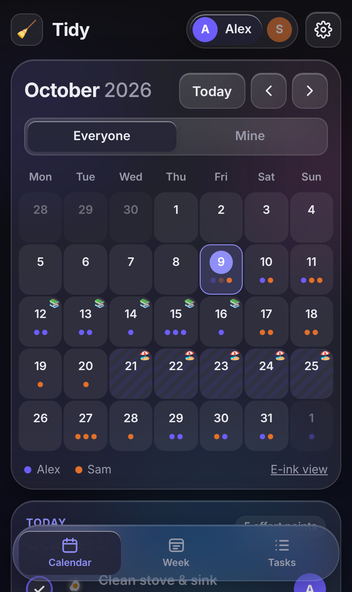
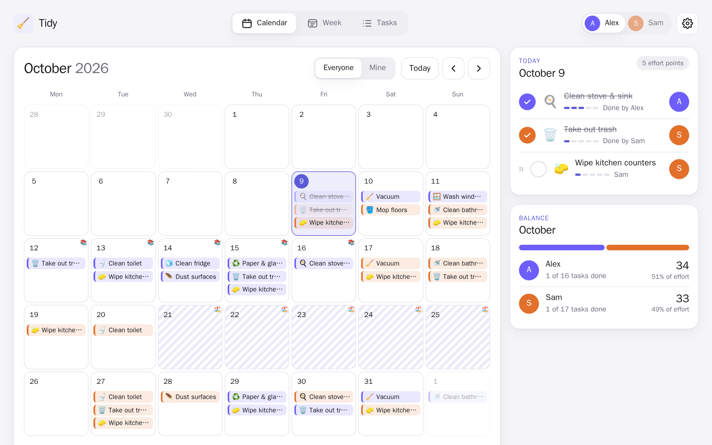
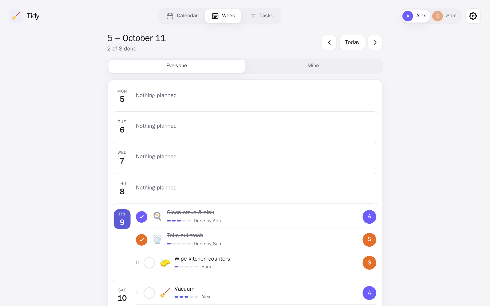
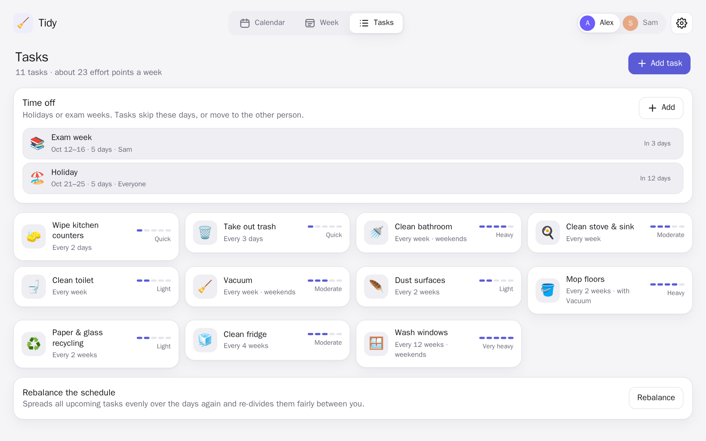

<div align="center">


# Tidy

**A shared household cleaning schedule that divides the chores fairly.**

</div>

> [!WARNING]
> **This project is entirely vibe coded.**
> I built Tidy for myself, to help with my own day-to-day chores, and it was written with an AI
> assistant rather than carefully coded by hand. I decided to put it online in case it is useful to
> someone else too.
>
> That means: no promise it won't break or that it will stay secure. Feel free to use it, but do so at your own risk.
> Back up your data, and expect rough edges. Issues and pull requests are welcome, but I can't promise a fast reply.

## Screenshots

<table>
  <tr>
    <td align="center"><br /><sub>Calendar</sub></td>
    <td align="center"><br /><sub>Week list</sub></td>
    <td align="center"><br /><sub>Drag a task to another day</sub></td>
  </tr>
  <tr>
    <td align="center"><br /><sub>Tasks and time off</sub></td>
    <td align="center"><br /><sub>Planning time off</sub></td>
    <td align="center"><br /><sub>Glass style, dark mode (experimental)</sub></td>
  </tr>
</table>



<details>
<summary>More desktop screenshots</summary>




</details>

## Features

- **Fair scheduling.** Tasks repeat at their own rhythm (every 2 days, every week, every 12 weeks, ...) and
  each occurrence goes to whoever has done the least work recently. Effort is rated from 1 to 5.
- **Calendar and week list.** A month calendar with a day panel, and a simple week list that is easy to read on a phone.
- **Tick things off** and see who did what, plus a monthly balance of the effort per person.
- **Move tasks to another day.** Drag a task by its grip handle (mouse or touch), or tap the handle to pick a
  day from a list that shows how busy each day is. Includes undo.
- **Time off.** Mark holidays, exam weeks or sick days for everyone or for one person. Tasks skip those days,
  or are taken over by the other people. Pick a preset label or write your own.
- **Smart rules.** Heavy tasks stay on weekends, a task can be linked to another one (mopping follows
  vacuuming), and a task isn't planned again right after it was done.
- **Calendar feeds.** Subscribe to a personal `.ics` feed per person in Apple Calendar, Google Calendar and others.
- **Installable on iPhone.** Add it to the home screen for a full-screen app without the browser bar.
- **Light, dark and glass.** Follows your device's theme, with an optional experimental frosted-glass style.
- **E-ink view.** A plain black and white board at `/eink` for e-readers and wall displays.
- **Self-hosted and simple.** A single container, a single SQLite file, no accounts.

## Getting started

### With Docker (recommended)

```bash
git clone https://github.com/RaihanKaskandar/tidy.git
cd tidy
docker compose up -d --build
```

Then open <http://localhost:3001> (or `http://<your-server>:3001` from another device). On first use you are
asked who shares the chores (up to six people), and Tidy starts you off with a list of common tasks that you can
edit or delete. Everything is stored in
the `tidy-data` Docker volume, so it survives updates and restarts.

To update, pull the latest code and run `docker compose up -d --build` again.

### Without Docker

You need [Node.js](https://nodejs.org) 22.18 or newer (the server runs TypeScript directly and uses the
built-in `node:sqlite`).

```bash
npm ci
npm run build
npm start
```

Then open <http://localhost:3001>. The database is created in `data/tidy.db`.

### Configuration

| Variable  | Default        | Description                                                      |
| --------- | -------------- | ---------------------------------------------------------------- |
| `PORT`    | `3001`         | Port the server listens on.                                      |
| `DB_PATH` | `data/tidy.db` | Where the SQLite database is stored (`/data/tidy.db` in Docker). |

### Add it to your iPhone

Open Tidy in Safari, tap **Share**, then **Add to Home Screen**. For a proper address you can put Tidy behind a
reverse proxy such as Nginx Proxy Manager or Caddy. Since there is no login, keep it on your home network or put
it behind something that adds authentication.

### Calendar feeds

Open **Settings** (the gear icon) and use **Subscribe** or **Copy link** next to a person. The feed lives at
`/ical/<name>.ics` and contains that person's tasks from two weeks back to twelve weeks ahead, as all-day events
that don't mark you as busy. Anyone who can reach the URL can read the feed, so the same advice about keeping Tidy
off the open internet applies. Your phone has to be able to reach the server for the feed to update.

### E-ink view

`/eink` shows a plain black and white board without JavaScript, made for e-readers and wall displays. It takes
optional query parameters:

| Parameter | Default | Description                                      |
| --------- | ------- | ------------------------------------------------ |
| `days`    | `7`     | Number of days to show (1–14).                   |
| `refresh` | `30`    | Minutes between automatic reloads (0 turns off). |
| `from`    | today   | First day to show, as `YYYY-MM-DD`.              |

For example: `http://<your-server>:3001/eink?days=3&refresh=60`.

### Backups

Everything lives in one SQLite database. With Docker, copy the whole data folder out of the container (the
`-wal` file next to the database can hold recent changes, so take all of it):

```bash
docker compose cp tidy:/data ./tidy-backup
```

To restore a backup:

```bash
docker compose stop
docker compose cp ./tidy-backup/. tidy:/data
docker compose start
```

Without Docker, stop the server and copy the `data/` folder.

## Development

```bash
npm install
npm run dev      # API on :3001 and the Vite dev server on :5173
```

| Script              | What it does                                      |
| ------------------- | ------------------------------------------------- |
| `npm run dev`       | Runs the API and the front end with live reload   |
| `npm run build`     | Type-checks and builds the front end into `dist/` |
| `npm start`         | Runs the server, which also serves `dist/`        |
| `npm run typecheck` | Type-checks the whole project                     |
| `npm run format`    | Formats the code with Prettier                    |

### Project structure

```
server/    Express API, SQLite storage and the scheduler
shared/    Types and rules used by both the server and the front end
src/       React front end (views in components/)
public/    App icons and web app manifest
scripts/   Helper scripts (generates the app icons)
docs/      Screenshots used in this README
```

## How scheduling works

Each task gets a start day chosen so the total effort per day stays as flat as possible, then repeats at its own
interval. Every occurrence goes to the person with the least effort over the last eight weeks, unless that would
overload them on a single day. Moving a task, handing it over, or adding time off changes only what you touch;
**Rebalance** on the Tasks page re-plans everything from scratch.

## Author

Designed and directed by **Raihan Kaskandar** ([@RaihanKaskandar](https://github.com/RaihanKaskandar)). The code was
written with Claude, an AI coding assistant.

## License

[MIT](LICENSE)
